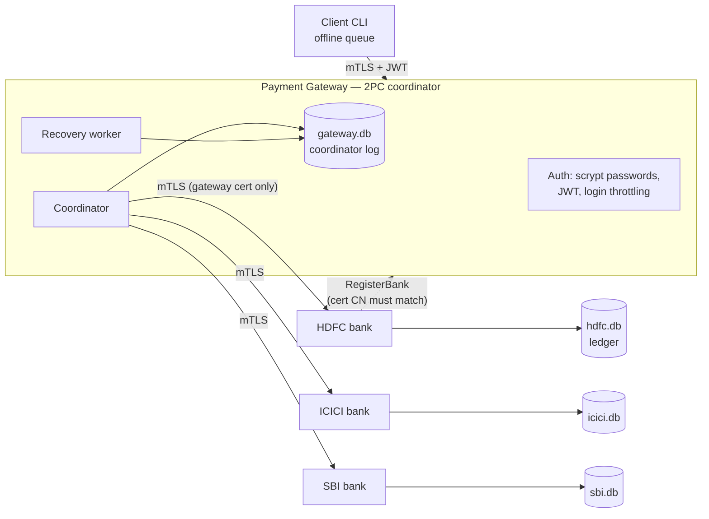

# Secure Distributed Payment Gateway

[](https://github.com/Parth-Babariya/Secure-Distributed-Payment-Gateway/actions/workflows/ci.yml)

A payment gateway that moves money between accounts at independent bank servers, built with Python and gRPC. Each transfer is **atomic across banks** using two-phase commit (2PC) with durable logs and automatic crash recovery. Every connection uses mutual TLS, and users authenticate with revocable JWT sessions.

The headline result: a chaos test sends payments continuously while hard-killing the gateway and banks at random. Afterwards it checks every payment against both banks' ledgers and confirms that each one either fully happened or did not happen at all, and that no money was created or lost.

The full design report, with correctness arguments and evaluation, is [Report.pdf](Report.pdf) (LaTeX source in [report/](report/)).

## Architecture



| Component | File | Role |
|---|---|---|
| Payment gateway | [server/payment_gateway.py](server/payment_gateway.py) | Authenticates users, validates payments, coordinates 2PC, recovers in-doubt transactions |
| Bank server | [server/bank_server.py](server/bank_server.py) | 2PC participant; durable SQLite ledger with fund reservations |
| Client | [client/client.py](client/client.py) | Interactive CLI; queues payments on disk while the gateway is unreachable |
| Interceptors | [server/interceptor.py](server/interceptor.py) | JWT authorization, certificate-identity checks, access logging with status and latency |
| Certificates | [scripts/gen_certs.py](scripts/gen_certs.py) | Generates a local CA and one certificate per component (never committed) |

## How a payment works

```
PREPARING --both banks vote yes--> COMMITTING --both acknowledge--> COMMITTED
    |
    +--a "no" vote, bank unreachable, or prepare timeout--> ABORTING --both acknowledge--> ABORTED
```

1. **Validate.** The gateway checks the JWT, that the amount is positive and within limits, and that the sender owns the source account and the receiver account exists. Amounts are integer **paise**, never floats.
2. **Log.** The payment is inserted as `PREPARING`. The client-generated transaction id is the primary key, so a retry with the same id returns the stored outcome instead of charging twice.
3. **Phase 1 (prepare).** The sender's bank *reserves* the funds, which reduces the available balance; the receiver's bank checks that the account exists. Each bank writes its vote to its own SQLite ledger before replying, so a bank that crashes after voting yes still honours the decision when it restarts.
4. **Decision.** The gateway durably records `COMMITTING` (or `ABORTING`) *before* telling any bank, using a compare-and-set on the status.
5. **Phase 2.** Commit and abort are idempotent at the banks, so the gateway can retry them safely. An abort for a transaction a bank never saw leaves a tombstone, so a delayed prepare arriving later is refused.
6. **Recovery.** A background worker, which also runs right after a restart, retries phase 2 for every `COMMITTING`/`ABORTING` payment until both banks acknowledge. A payment stuck in `PREPARING` past a timeout is aborted (*presumed abort*), because no commit decision was ever logged.

**Why double spending is impossible.** A bank's funds check and its reservation run in one serialised SQLite transaction (`BEGIN IMMEDIATE`). Two concurrent payments therefore cannot both pass the check. The test suite fires 40 concurrent ₹100 payments at a ₹1,500 balance and asserts exactly 15 succeed.

## Security model

| Threat | Mitigation |
|---|---|
| Eavesdropping or tampering | mTLS on every hop; the CA signs a separate certificate for each component |
| Leaked keys in the repository | No keys are committed. `scripts/gen_certs.py` creates them locally, in Docker, and in tests |
| Calling a bank directly to mint or move money | Banks accept calls only from the certificate with CN `gateway` |
| Impersonating a bank to divert its traffic | `RegisterBank` requires the caller's certificate CN to be `<bank>.bank` |
| Negative or oversized amounts | Validated on the server; the banks also reject amounts ≤ 0 |
| Stolen password database | Passwords are stored as salted scrypt hashes and compared in constant time; logins for unknown users take the same time |
| Password guessing | 5 failures within 5 minutes lock the username for 60 s |
| Token theft after logout | Each JWT has a `jti` that logout revokes; the revocation list is persisted, so it survives restarts |
| Weak or hard-coded JWT secret | Read from `PG_JWT_SECRET`, at least 32 characters; a random per-process secret is used if it is unset |
| Reusing another user's transaction id | Idempotency is bound to the user and the payment parameters; a mismatch returns `ALREADY_EXISTS` |

## Quick start

### Docker (recommended)

```sh
docker compose up --build -d      # generates certs, starts gateway + HDFC, ICICI, SBI
docker compose run --rm client    # interactive client
docker compose down -v            # stop and delete state
```

### Local

```sh
python -m venv .venv && .venv/Scripts/activate      # or: source .venv/bin/activate
pip install -r requirements-dev.txt
python scripts/gen_certs.py

cd server
python payment_gateway.py          # terminal 1
python bank_server.py HDFC 60051   # terminal 2
python bank_server.py ICICI 60052  # terminal 3
python bank_server.py SBI 60053    # terminal 4
python ../client/client.py         # terminal 5
```

Demo users (passwords are stored hashed in [server/users.json](server/users.json); add users with `scripts/hash_password.py`):

| User | Password | Accounts |
|---|---|---|
| alice | alice123 | HDFC 1001, SBI 3001 |
| bob | bob123 | ICICI 2001 |
| jack | jack123 | ICICI 2002 |
| carol | carol123 | HDFC 1002 |

Opening balances come from [server/bank_data.json](server/bank_data.json) the first time each bank starts. After that, each bank's ledger in `data/<bank>.db` is the source of truth.

<details>
<summary>Configuration (environment variables)</summary>

| Variable | Default | Meaning |
|---|---|---|
| `PG_JWT_SECRET` | random per process | HS256 signing key (≥ 32 chars) |
| `PG_CERT_DIR` / `PG_DATA_DIR` | `certs/` / `data/` | Certificate and database locations |
| `PG_GATEWAY_ADDRESS` | `localhost:50052` | Where banks and clients find the gateway |
| `PG_BANK_HOST` | `localhost` | Host name a bank registers itself under |
| `PG_PREPARE_TIMEOUT` | `30` | Seconds before an undecided payment is presumed aborted |
| `PG_BANK_RPC_TIMEOUT` | `3` | Deadline for each gateway → bank call |
| `PG_SQLITE_SYNC` | `FULL` | `FULL` fsyncs every commit; `NORMAL` survives process crashes but not OS crashes |
</details>

## Testing

```sh
pytest -q                                   # 33 tests, ~25 s
python scripts/chaos_demo.py --seconds 60   # kill processes mid-payment, then audit
python scripts/benchmark.py                 # throughput and latency
```

The [tests](tests/) start a gateway and three banks in-process on free ports and cover:

- **Payments.** Cross-bank transfers, insufficient funds, server-side amount validation, a specific status code for each error, idempotent retries, a concurrent double-spend attempt, and 120 random concurrent transfers that must conserve money.
- **Security.** Missing, forged, expired and revoked tokens; revocation surviving a restart; login lockout; reading another user's account; bank impersonation; non-gateway callers hitting a bank.
- **Recovery (fault injection).**
  - A receiver bank's commit fails, then the retry succeeds.
  - A bank is down during prepare.
  - The gateway crashes after the commit decision.
  - The gateway crashes before any decision (presumed abort).
  - A bank crashes after voting yes.
  - A late prepare arrives after the abort.
- **Client.** Rupee parsing; an offline payment queued to disk and sent exactly once after the gateway returns.

CI runs the suite, the chaos demo, a check that the generated protobuf code is up to date, and a Docker Compose smoke test.

### Chaos demo

`scripts/chaos_demo.py` runs the gateway and banks as separate OS processes. Eight client threads send random payments while a random component is **hard-killed** (`SIGKILL`/`TerminateProcess`) and restarted every 1–3 s. After the load stops and recovery settles, it audits the gateway log against every bank ledger. A 40 s run on a laptop:

```
Kills:            {'GATEWAY': 4, 'SBI': 4, 'HDFC': 5, 'ICICI': 2} (15 total)
Client outcomes:  {'COMMITTED': 2241, 'ABORTED': 470, 'rpc:UNAVAILABLE': 32, 'COMMITTING': 7, 'ABORTING': 1}
Logged payments:  2747 -> {'ABORTED': 483, 'COMMITTED': 2264}
Money:            opening 2300000 paise, closing 2300000 paise
PASSED: every payment is atomic, nothing in doubt, money conserved
```

The recovery worker settled 158 payments that were in doubt when a process died: 117 committed and 41 aborted. Ten of those 41 had been left in `PREPARING` by a gateway crash and were presumed aborted.

### Benchmark

End-to-end payments (gateway and three banks as separate processes, mTLS on every hop, Windows laptop, 8 s per level):

| Concurrent clients | TPS (`FULL` fsync) | p50 / p99 ms | TPS (`NORMAL`) | p50 / p99 ms |
|---:|---:|---:|---:|---:|
| 1 | 57 | 16 / 29 | 118 | 8 / 21 |
| 4 | 77 | 42 / 328 | 187 | 20 / 40 |
| 16 | 49 | 319 / 489 | 208 | 72 / 134 |
| 32 | 67 | 391 / 713 | 226 | 134 / 221 |

Each payment makes three durable writes at the gateway and two at each bank. With `FULL` durability, fsync is the bottleneck: relaxing it to `NORMAL` gives about 4× the throughput. The next step would be group commit, batching the log writes of many concurrent payments into one fsync.

## Limitations and next steps

- **The coordinator is a single point of failure.** 2PC is a blocking protocol: while the gateway is down, prepared reservations stay held until it recovers, which is safe but not available. Running the coordinator log on a replicated store (Raft or Paxos) would remove this; it is what systems like Spanner do.
- **One SQLite connection per process** serialises writes. A production system would use PostgreSQL and group commit.
- **Users live in a JSON file**, and the JWT uses a single shared HS256 key. A real deployment would use a user database and asymmetric keys (RS256 or EdDSA) with rotation.
- **Prepare runs sequentially** at the two banks; running both in parallel would cut latency.

## Repository layout

```
protofiles/   gRPC service definitions (.proto) and generated code
server/       payment_gateway.py, bank_server.py, auth.py, interceptor.py, storage.py, tls.py, config.py
client/       client.py
scripts/      gen_certs.py, hash_password.py, chaos_demo.py, benchmark.py, cluster.py
tests/        pytest suite and in-process harness
```
