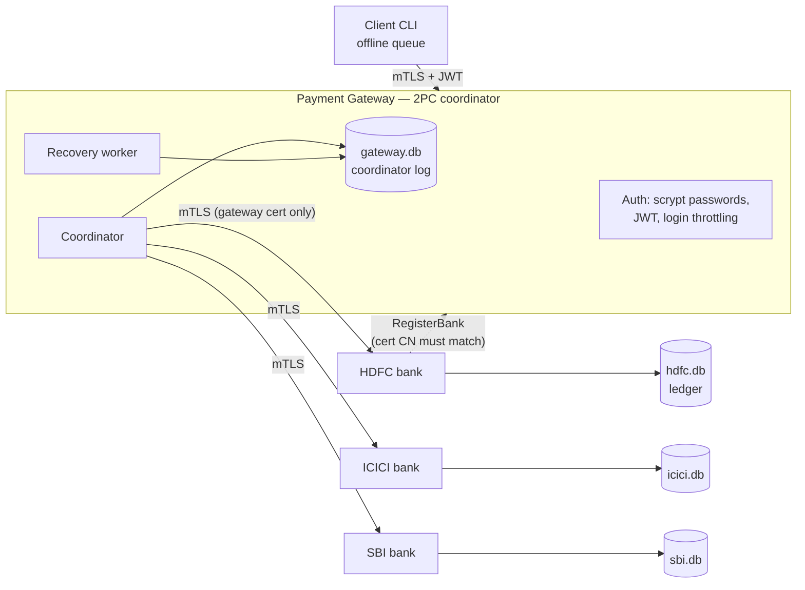
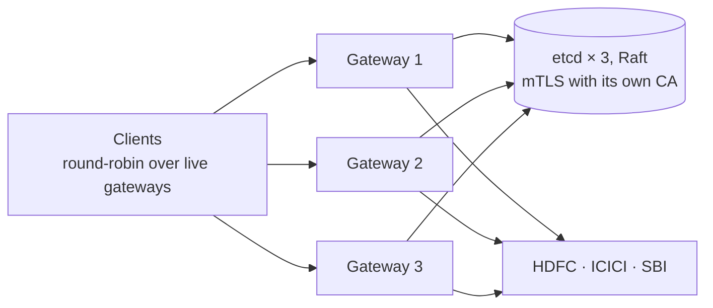

# Secure Distributed Payment Gateway

[](https://github.com/Parth-Babariya/Secure-Distributed-Payment-Gateway/actions/workflows/ci.yml)

A payment gateway that moves money between accounts at independent bank servers, built with Python and gRPC. Each transfer is **atomic across banks** using two-phase commit (2PC) with durable logs and automatic crash recovery. Every connection uses mutual TLS, and users authenticate with revocable JWT sessions.

The coordinator can run as **several gateways sharing a Raft-replicated log** in etcd. If a gateway crashes, another one finishes its payments, so the classic weakness of 2PC, a blocked coordinator, goes away.

The headline result: a chaos test sends payments continuously while hard-killing gateways, banks and etcd nodes at random. Afterwards it checks every payment against both banks' ledgers and confirms that each one either fully happened or did not happen at all, and that no money was created or lost.

The full design report, with correctness arguments and evaluation, is [Report.pdf](Report.pdf) (LaTeX source in [report/](report/)).

## Architecture



| Component | File | Role |
|---|---|---|
| Payment gateway | [server/payment_gateway.py](server/payment_gateway.py) | Authenticates users, validates payments, coordinates 2PC, recovers in-doubt transactions |
| Bank server | [server/bank_server.py](server/bank_server.py) | 2PC participant; durable SQLite ledger with fund reservations |
| Client | [client/client.py](client/client.py) | Interactive CLI; queues payments on disk while the gateway is unreachable |
| Interceptors | [server/interceptor.py](server/interceptor.py) | JWT authorization, certificate-identity checks, access logging with status and latency |
| Certificates | [scripts/gen_certs.py](scripts/gen_certs.py) | Generates a local CA and one certificate per component (never committed) |
| Storage | [server/storage.py](server/storage.py) | SQLite with group commit: one writer thread, one fsync per batch |
| Replicated log | [server/etcd_log.py](server/etcd_log.py) | The coordinator log in etcd, for running several gateways |

## How a payment works

```
PREPARING --both banks vote yes--> COMMITTING --both acknowledge--> COMMITTED
    |
    +--a "no" vote, bank unreachable, or prepare timeout--> ABORTING --both acknowledge--> ABORTED
```

1. **Validate.** The gateway checks the JWT, that the amount is positive and within limits, and that the sender owns the source account and the receiver account exists. Amounts are integer **paise**, never floats.
2. **Log.** The payment is inserted as `PREPARING`. The client-generated transaction id is the primary key, so a retry with the same id returns the stored outcome instead of charging twice.
3. **Phase 1 (prepare).** Both banks are asked in parallel. The sender's bank *reserves* the funds, which reduces the available balance; the receiver's bank checks that the account exists. Each bank writes its vote to its own SQLite ledger before replying, so a bank that crashes after voting yes still honours the decision when it restarts.
4. **Decision.** The gateway durably records `COMMITTING` (or `ABORTING`) *before* telling any bank, using a compare-and-set on the status.
5. **Phase 2.** Commit and abort are idempotent at the banks, so the gateway can retry them safely. An abort for a transaction a bank never saw leaves a tombstone, so a delayed prepare arriving later is refused.
6. **Recovery.** A background worker, which also runs right after a restart, retries phase 2 for every `COMMITTING`/`ABORTING` payment until both banks acknowledge. A payment stuck in `PREPARING` past a timeout is aborted (*presumed abort*), because no commit decision was ever logged.

**Why double spending is impossible.** A bank's funds check and its reservation run as one step on the bank's single database writer, in their own savepoint. Two concurrent payments therefore cannot both pass the check. The test suite fires 40 concurrent ₹100 payments at a ₹1,500 balance and asserts exactly 15 succeed.

## Replicated coordinator (optional)

Two-phase commit has one well-known weakness. If the coordinator dies after the banks have prepared, their reservations stay held until it comes back. With `PG_ETCD_ENDPOINTS` set, the coordinator log moves from `gateway.db` to a three-node **etcd** cluster, which replicates every write to a majority of nodes with Raft. Any number of gateways can then share it:



- **No gateway owns a payment.** Every status change is an etcd transaction conditioned on the record's revision, the same compare-and-set used with SQLite. A gateway running a payment and another recovering it cannot both win; the loser follows the logged decision. If a gateway dies, the others' recovery workers finish its decided payments and presume abort for its undecided ones.
- **Shared session state.** Bank registrations, revoked tokens and login lockouts live in etcd, so a token from one gateway works at all of them, a logout anywhere revokes it everywhere, and a lockout applies at every gateway. Revocations and failed-login records sit on etcd leases and expire by themselves. Tokens verify at every gateway because they share the signing keys.
- **Tolerates one failure of each kind.** A gateway can die, since clients and banks list every gateway (`PG_GATEWAY_ADDRESS=ip:port,ip:port,...`) and gRPC sends calls only to live ones. An etcd node can die too: two of three are still a majority.
- **Only gateways can reach the store.** etcd uses mutual TLS for clients and for its Raft peers, with a separate CA. A bank or client certificate is refused.

```sh
python scripts/get_etcd.py                                  # etcd v3.6.16, SHA-256 checked, into .tools/
python scripts/chaos_demo.py --seconds 60 --replicated      # 3 etcd + 3 gateways + 3 banks, all killed at random
python scripts/benchmark.py --replicated
```

The cost is latency, because every state change is now a consensus write. On this laptop the replicated setup ran at about 26–30 payments/s with p50 33 ms for one client, against roughly 67/s and 14 ms for the single gateway. At 32 clients it reached about 182 payments/s against 256–270. Interleaved runs, 8 s per level:

| Clients | Single gateway, SQLite (TPS) | p50 / p99 ms | 3 gateways, etcd (TPS) | p50 / p99 ms |
|---:|---:|---:|---:|---:|
| 1 | 67 | 14 / 32 | 26–30 | 33 / 45–121 |
| 4 | 114–125 | 27 / 300 | 62–69 | 53–59 / 140–345 |
| 16 | 205–274 | 52–73 / 160–320 | 133–139 | 113–116 / 156–383 |
| 32 | 256–270 | 115–122 / 353–363 | 181–183 | 174–175 / 233–235 |

## Security model

| Threat | Mitigation |
|---|---|
| Eavesdropping or tampering | mTLS on every hop; the CA signs a separate certificate for each component |
| Leaked keys in the repository | No keys are committed. `scripts/gen_certs.py` creates them locally, in Docker, and in tests |
| One compromised container exposing every key | In Docker each container mounts only its own key, its certificate and `ca.crt`; the CA key is in a volume no running service mounts (checked in CI) |
| Calling a bank directly to mint or move money | Banks accept calls only from the certificate with CN `gateway` |
| Impersonating a bank to divert its traffic | `RegisterBank` requires the caller's certificate CN to be `<bank>.bank` |
| Using a bank or gateway certificate to act as a user | User RPCs accept only the `client` certificate, even with a valid JWT |
| Negative or oversized amounts | Validated on the server; the banks also reject amounts ≤ 0 |
| Stolen password database | Passwords are stored as salted scrypt hashes and compared in constant time; logins for unknown users take the same time |
| Password guessing | 5 failures in 5 minutes per (username, client address), and 20 per client address across all usernames, lock further attempts for 60 s. Attempts are counted per address, so an attacker cannot lock the real user out from elsewhere; the counts are stored, so a restart does not reset them |
| Token theft after logout | Each JWT has a `jti` that logout revokes; the revocation list is persisted, so it survives restarts |
| Forged or replayed session tokens | Tokens are EdDSA (Ed25519) JWTs; only the gateway holds the private key, and anything that only verifies needs just the public key. Only `EdDSA` is accepted, so `alg: none` and HS256 tokens "signed" with the public key are refused |
| A long-lived signing key | Keys rotate without logging anyone out: each token names its key (`kid`), a new key starts signing at once, and the old key keeps verifying until its tokens expire (`scripts/rotate_jwt_key.py`). In Docker the keys live in a volume only the gateway mounts |
| Reaching the replicated log directly | etcd requires mutual TLS with a certificate from its own CA, which only gateways hold; its Raft peers authenticate each other the same way |
| Reusing another user's transaction id | Idempotency is bound to the user and the payment parameters; a mismatch returns `ALREADY_EXISTS` |

## Quick start

### Docker (recommended)

```sh
docker compose up --build -d      # generates certs, starts gateway + HDFC, ICICI, SBI
docker compose run --rm client    # interactive client
docker compose down -v            # stop and delete state
```

### Local

```sh
python -m venv .venv && .venv/Scripts/activate      # or: source .venv/bin/activate
pip install -r requirements-dev.txt
python scripts/gen_certs.py

cd server
python payment_gateway.py          # terminal 1
python bank_server.py HDFC 60051   # terminal 2
python bank_server.py ICICI 60052  # terminal 3
python bank_server.py SBI 60053    # terminal 4
python ../client/client.py         # terminal 5
```

Session tokens are signed with an Ed25519 key that `gen_certs.py` puts in `certs/jwt/`. To rotate it:

```sh
python scripts/rotate_jwt_key.py new             # new key signs from now on
python scripts/rotate_jwt_key.py list
python scripts/rotate_jwt_key.py retire <old-kid>  # after one token lifetime: verify-only
```

Demo users (passwords are stored hashed in [server/users.json](server/users.json); add users with `scripts/hash_password.py`):

| User | Password | Accounts |
|---|---|---|
| alice | alice123 | HDFC 1001, SBI 3001 |
| bob | bob123 | ICICI 2001 |
| jack | jack123 | ICICI 2002 |
| carol | carol123 | HDFC 1002 |

Opening balances come from [server/bank_data.json](server/bank_data.json) the first time each bank starts. After that, each bank's ledger in `data/<bank>.db` is the source of truth.

<details>
<summary>Configuration (environment variables)</summary>

| Variable | Default | Meaning |
|---|---|---|
| `PG_JWT_KEY_DIR` | `certs/jwt/` | Ed25519 token signing keys (created by `gen_certs.py`; an in-memory key is used if empty) |
| `PG_CERT_DIR` / `PG_DATA_DIR` | `certs/` / `data/` | Certificate and database locations |
| `PG_GATEWAY_ADDRESS` | `localhost:50052` | Where banks and clients find the gateway; several as `ip:port,ip:port` |
| `PG_BANK_HOST` | `localhost` | Host name a bank registers itself under |
| `PG_PREPARE_TIMEOUT` | `30` | Seconds before an undecided payment is presumed aborted |
| `PG_BANK_RPC_TIMEOUT` | `3` | Deadline for each gateway → bank call |
| `PG_SQLITE_SYNC` | `FULL` | `FULL` fsyncs every commit; `NORMAL` survives process crashes but not OS crashes |
| `PG_GROUP_COMMIT` | `1` | `0` commits each write on its own (for A/B comparisons) |
| `PG_ETCD_ENDPOINTS` | unset | Comma-separated etcd endpoints; when set, the coordinator log lives in etcd and several gateways can share it |
| `PG_ETCD_CERT_DIR` | `certs/etcd/` | etcd CA and the gateways' client certificate (created by `gen_certs.py`) |
</details>

## Testing

```sh
pytest -q                                   # 55 tests, ~30 s (6 need etcd: scripts/get_etcd.py)
python scripts/chaos_demo.py --seconds 60   # kill processes mid-payment, then audit
python scripts/benchmark.py                 # throughput and latency
```

The [tests](tests/) start a gateway and three banks in-process on free ports and cover:

- **Payments.** Cross-bank transfers, insufficient funds, server-side amount validation, a specific status code for each error, idempotent retries, a concurrent double-spend attempt, and 120 random concurrent transfers that must conserve money.
- **Security.** Missing, forged (right key id, wrong key), expired and revoked tokens; revocation surviving a restart; login lockout scoped to the client address and surviving a restart; password spraying across usernames; reading another user's account; bank impersonation; non-client certificates calling user RPCs; non-gateway callers hitting a bank; the per-component key layout.
- **Recovery (fault injection).**
  - A receiver bank's commit fails, then the retry succeeds.
  - A bank is down during prepare.
  - The gateway crashes after the commit decision.
  - The gateway crashes before any decision (presumed abort).
  - A bank crashes after voting yes.
  - A late prepare arrives after the abort.
- **Client.** Rupee parsing; an offline payment queued to disk and sent exactly once after the gateway returns.
- **Tokens.** EdDSA tokens naming their key; algorithm-confusion (HS256 with the public key), `alg: none` and wrong-issuer tokens refused; a rotation that keeps old sessions valid, then retiring and removing the old key.
- **Replicated coordinator** (real three-node etcd cluster). Sessions, payments, idempotent retries, logout and lockouts work across gateways. One gateway finishes, or presumes aborted, payments left by another that crashed. Payments continue with an etcd node down. Racing compare-and-sets have exactly one winner.
- **Storage.** Concurrent writes share commits; a failing write in a batch rolls back only itself; data is on disk when `write()` returns.

CI installs etcd and runs the suite, both chaos demos (single and replicated), a check that the generated protobuf code is up to date, and a Docker Compose smoke test that also checks each container holds only its own key.

### Chaos demo

`scripts/chaos_demo.py` runs the gateway and banks as separate OS processes. Eight client threads send random payments while a random component is **hard-killed** (`SIGKILL`/`TerminateProcess`) and restarted every 1–3 s. After the load stops and recovery settles, it audits the gateway log against every bank ledger. Two 60 s runs on a laptop:

```
$ python scripts/chaos_demo.py --seconds 60
Kills:            {'GATEWAY': 5, 'SBI': 7, 'HDFC': 6, 'ICICI': 3} (21 total)
Client outcomes:  {'COMMITTED': 5877, 'ABORTED': 1292, 'rpc:UNAVAILABLE': 40, 'COMMITTING': 8, 'ABORTING': 3}
Logged payments:  7214 -> {'COMMITTED': 5903, 'ABORTED': 1311}
Money:            opening 2300000 paise, closing 2300000 paise
PASSED: every payment is atomic, nothing in doubt, money conserved

$ python scripts/chaos_demo.py --seconds 60 --replicated
Kills:            {'GATEWAY-2': 2, 'ETCD-2': 3, 'HDFC': 5, 'ETCD-1': 2, 'GATEWAY-1': 3, 'SBI': 2, 'ETCD-3': 4, 'ICICI': 1} (22 total)
Client outcomes:  {'ABORTED': 726, 'COMMITTED': 3422, 'rpc:UNAVAILABLE': 13, 'COMMITTING': 5}
Logged payments:  4164 -> {'COMMITTED': 3433, 'ABORTED': 731}
Money:            opening 2300000 paise, closing 2300000 paise
PASSED: every payment is atomic, nothing in doubt, money conserved
```

In the replicated run, nine etcd kills and five gateway kills did not lose a single decision. Recovery workers settled 46 payments that were in doubt when a process died, often on a gateway other than the one that started them: 25 committed and 21 aborted. Seven of the aborts were payments left in `PREPARING`, which were presumed aborted. Clients saw `UNAVAILABLE` on 0.3% of calls, against 0.6% with a single gateway. Those failures are the calls in flight on a gateway at the moment it was killed.

### Benchmark

End-to-end payments (gateway and three banks as separate processes, mTLS on every hop, Windows laptop, 8 s per level). With group commit:

| Concurrent clients | TPS (`FULL` fsync) | p50 / p99 ms | TPS (`NORMAL`) | p50 / p99 ms |
|---:|---:|---:|---:|---:|
| 1 | 64 | 14 / 25 | 123 | 8 / 16 |
| 4 | 165 | 24 / 37 | 325 | 12 / 23 |
| 16 | 282 | 52 / 105 | 313 | 48 / 100 |
| 32 | 311 | 98 / 350 | 364 | 87 / 134 |

`FULL` figures are medians of three rounds (`python scripts/benchmark.py --ab PG_GROUP_COMMIT 0 1`).

**Group commit.** Each payment makes three durable writes at the gateway and two at each bank. Previously every write waited for its own fsync, so under `FULL` throughput levelled off at about 120–140 payments/s whatever the client count. Now each process has one writer thread. It takes every write that is waiting, runs each in its own savepoint, and commits the whole batch with a single fsync, and no caller gets a reply before that commit. Interleaved runs against the previous code:

| `FULL`, clients | Before (TPS) | Group commit (TPS) |
|---:|---:|---:|
| 16 | 63–128 | 282–297 |
| 32 | 133–148 | 311–352 |

Throughput under full durability is now 2–2.5× higher at 16–32 clients and close to the `NORMAL` figures, so the durability setting has stopped being the bottleneck. A single client gains nothing, because there is nothing to batch. Below about four clients, results vary up to 2–3× between runs on this laptop because flush latency is noisy.

**Parallel prepare (A/B).** Three runs each of sequential and parallel prepare were alternated under `NORMAL`. Parallel prepare cut single-client median latency from 10.2 ms to 8.1 ms and raised single-client throughput from 92 to 110 payments/s. At 4–16 clients the two were within run-to-run noise, because throughput there is limited by serialised database writes, not by the round trip. Under `FULL` the fsync noise was larger than the difference.

## Limitations and next steps

- **Each bank is a single server.** The coordinator can be replicated, but a bank that is down still blocks payments involving it. Its reservations are held until it returns, which is safe but not available. A real bank would replicate its ledger too.
- **Gateways compare wall-clock times** to decide when an undecided payment has timed out. Large clock skew between gateways could presume-abort a payment early. That is still safe, since the payment aborts atomically, but it is a needless abort. NTP keeps the skew far below the 30 s timeout.
- **Docker Compose runs one gateway on SQLite.** The replicated layout runs as local processes (`--replicated`), not yet in Compose.
- **One writer per process.** Group commit batches the fsyncs, but each process still applies its writes one at a time on a single SQLite connection. A production system would use PostgreSQL with row-level locking.
- **Users live in a JSON file.** A real deployment would use a user database, and keep token signing keys in a KMS or HSM rather than on disk.

## Repository layout

```
protofiles/   gRPC service definitions (.proto) and generated code
server/       payment_gateway.py, bank_server.py, auth.py, jwt_keys.py, etcd_log.py, interceptor.py, storage.py, tls.py, config.py
client/       client.py
scripts/      gen_certs.py, rotate_jwt_key.py, get_etcd.py, hash_password.py, chaos_demo.py, benchmark.py, cluster.py
tests/        pytest suite and in-process harness
```
